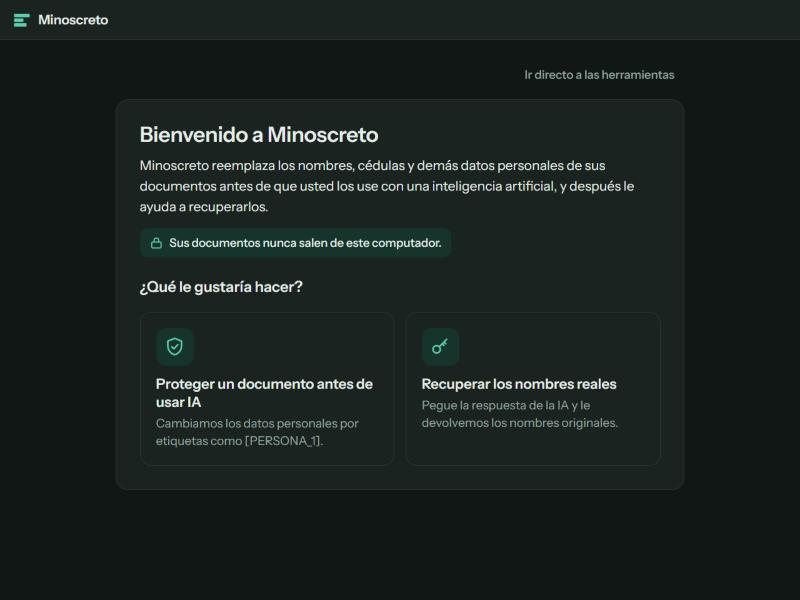

# Minoscreto

**Live:** https://minoscreto.netlify.app

Anonimiza documentos Word y expedientes PDF antes de usar IA y restaura los nombres después. Todo corre en el navegador: el documento nunca sale del computador.

*In English:* a browser-only tool for Colombian legal documents. It replaces names, ID numbers (cédulas) and other personal data with tags like `[PERSONA_1]` before the text goes to an AI, then puts the real names back into the AI's answer. Built with React 19 and Vite; 160 automated tests (Vitest + Testing Library) run on every push.

## Pruebas
- 160 pruebas en 10 archivos (`tests/`): detección de nombres, direcciones y cédulas, división de líneas, puntajes, expediente PDF/Word, descargas y la interfaz.
- Corren en cada push con GitHub Actions (`.github/workflows/test.yml`): `npm ci`, `npm test`, `npm run build`.
- `npm run eval` mide el recall y la precisión de la detección con documentos reales etiquetados, que viven fuera del repo (Ley 1581).

## Comandos
- `npm install`
- `npm run dev` – desarrollo
- `npm test` – pruebas (Vitest)
- `npm run build` – genera `dist/index.html`, un único archivo autocontenido

## Estructura (MVVM)
- `src/model/` – lógica pura sin React: detección, entidades, análisis, diccionario y manejo de .docx (`docx/`).
- `src/viewmodels/` – hooks con el estado y las acciones: `useAnonymizer`, `useRestorer`, reducer en `anonymizerState.js`, descargas y avisos.
- `src/views/` y `src/components/` – componentes de presentación; solo reciben el view-model por props.
- `src/styles/` – CSS por área. `tests/` – pruebas del modelo y de la app.

## Modo expediente (PDF o Word largo → texto anonimizado para la IA)
Pestaña **Expediente**. Lee la capa de texto de un PDF ya pasado por OCR (por ejemplo, en Acrobat) con pdf.js, o los párrafos de un Word (.docx; las páginas salen de la última paginación que guardó Word y, si no hay, se ubica por número de párrafo), reconstruye los párrafos con su folio, anonimiza con la misma detección y exporta texto: un `.md` con marcas `[Folio N]` o un ZIP con partes («Parte X de N · folios A–B» + instrucción para la IA), el diccionario en `NO-SUBIR/` y `LEAME.txt`.
- Lógica pura en `src/model/expediente/` (párrafos, reducción, corrección 0/1 del OCR, división, exportación, variantes de OCR). `pdfjs.js` es lo único que toca pdf.js.
- Estado en `src/viewmodels/useExpediente.js`; detección y anonimización corren en un Web Worker (`src/workers/`).
- pdf.js y su worker van en línea dentro de `dist/index.html` (sube de ~0,4 MB a ~2,2 MB; ~0,67 MB comprimido) y solo se cargan al abrir un PDF. No hay peticiones de red con el documento.
- Prueba de punta a punta: `python scripts/make-expediente-pdf.py .local/expediente-600.pdf 600` y luego `node scripts/bench-expediente.mjs .local/expediente-600.pdf .local/expediente-600.verdad.json`.

## Descargas
Un solo botón «Descargar»: baja el documento protegido (`<nombre>_protegido.docx` o `.md`) y, medio segundo después, su diccionario (`<nombre>_diccionario.json`), para que no se pueda olvidar. Queda a la vista una lista con ambos y «Descargar diccionario de nuevo» por si el navegador bloqueó la segunda descarga. Un expediente en varias partes baja como un solo `<nombre>_protegido.zip` (partes, diccionario y `LEAME.txt`). «Copiar texto para la IA» (o «Copiar parte X de N») copia el texto protegido sin descomprimir nada. Restaurar acepta el diccionario o ese .zip.
